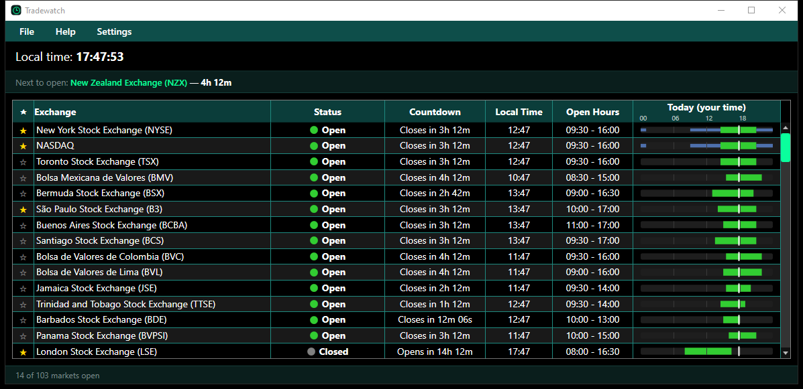

# Tradewatch

A small Windows desktop app that shows, at a glance, which of the world's stock exchanges are open right now.

## Features

- **103 exchanges** across every region, with live status (Open / Closed / Holiday), lunch breaks where an exchange has one, and a countdown to the next open or close.
- **Holiday calendars** with holiday names and early closes (see [tools/README.md](tools/README.md) for where the data comes from).
- **Pre-market and after-hours** sessions for NYSE and NASDAQ.
- **"Next to open"** bar: double-click the name to jump to that exchange.
- **Optional timeline column** showing each exchange's trading day in your own time zone.
- **Star / pin** exchanges, **group by region**, and a **compact mode** that only shows your pinned ones.
- **Tray icon** that turns green when any of your exchanges is open, plus notifications when one opens or closes.
- Dark and light themes, always-on-top, and **Start with Windows** (starts quietly in the tray).

## Download

Grab `Tradewatch.exe` from the [latest release](https://github.com/joseoguedes/trade-watch/releases/latest). It is a single file: no installer and nothing else to install. Put it somewhere permanent (for example `C:\Users\<you>\Apps\Tradewatch\`) and run it.

The exe isn't code-signed, so the first time you run it Windows SmartScreen may say "Windows protected your PC". Click **More info → Run anyway**.

Settings are saved in `%APPDATA%\Tradewatch\settings.json`.

## Building from source

Requires the [.NET 8 SDK](https://dotnet.microsoft.com/download/dotnet/8.0) on Windows.

    dotnet run --project Tradewatch

Tests (open/closed logic against the real exchange and holiday data):

    dotnet test Tradewatch.Tests

Single-file exe (the same as the release):

    dotnet publish Tradewatch/Tradewatch.csproj -c Release -r win-x64 --self-contained true -p:PublishSingleFile=true -o publish

## Making a release

Bump `<Version>` in `Tradewatch/Tradewatch.csproj`, commit, then tag and push:

    git tag v1.0.0
    git push origin v1.0.0

The Release workflow builds `Tradewatch.exe` and publishes it on the Releases page.

## Updating holiday data

See [tools/README.md](tools/README.md). India and China 2027 dates are estimates until the official schedules come out (around December 2026).
